[LinkedIn](https://www.linkedin.com/in/bodyaga-mosiichuk-785434314/) &nbsp;&nbsp; [Zalizna Zmina](https://www.ironsquad.org.ua/) &nbsp;&nbsp; [Hotkey Launcher](https://github.com/Norexel/hotkey-launcher)

