&nbsp;&nbsp;<a href="https://www.ironsquad.org.ua/"></a>&nbsp;&nbsp;<a href="https://github.com/Norexel?tab=repositories"></a>




<a href="https://www.ironsquad.org.ua/"></a>
<a href="https://github.com/Norexel/hotkey-launcher"></a><a href="https://github.com/Norexel/algebra-platform"></a>

